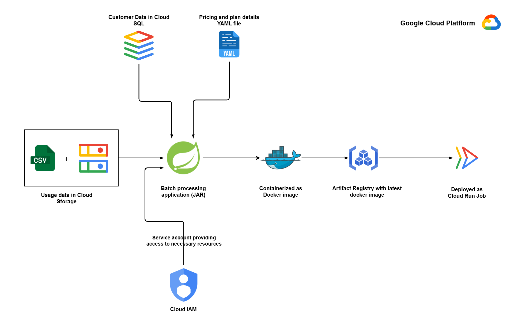

# Spring Batch Invoice Generation Application

## Overview

This project is a scalable Spring Batch application designed for automated monthly invoice generation in a subscription-based SaaS service (e.g., cloud storage similar to Dropbox or Google Drive). It efficiently processes large-scale customer data, usage metrics, and pricing rules to compute charges, apply discounts, and generate invoices. The app handles millions of records with fault tolerance, restartability, and parallelism, making it suitable for production environments.

The core functionality involves reading customer details from a PostgreSQL database, loading usage data from CSV files, parsing pricing from YAML, joining the data for calculations (prorated base charges, overages for storage/bandwidth/API calls), and outputting invoices to a database or files. It addresses real-world challenges like mid-month subscriptions, data validation, and scalability for high-volume billing.

To make this a production-ready solution, the application incorporates cloud-native features:

- Integration with Google Cloud SQL (PostgreSQL) for managed, scalable storage.
- Support for Google Cloud Storage (GCS) for remote CSV files in production.
- Containerization using Docker with multi-stage builds for consistent deployments.
- Image management in Google Artifact Registry for secure versioning.
- Deployment as a Cloud Run Job on Google Cloud Platform (GCP), enabling scheduled or on-demand executions with serverless scaling.

This demonstrates end-to-end DevOps practices, from local development to cloud deployment, serving as a practical example for building batch processing applications in a modern cloud ecosystem.


## Business Use-Case

In a subscription-based SaaS business, monthly invoicing for thousands to millions of customers involves aggregating subscription details, usage metrics (e.g., storage consumed, bandwidth, API calls), and applying tiered pricing. Manual processing is error-prone and unscalable, leading to delays or inaccuracies.

The batch job runs monthly (e.g., on the 1st) to:

1. **Load Data:** Read active customers from the database, usage from CSV (e.g., supplier logs), and pricing rules from YAML.
2. **Validate and Join:** Match customers with usage data, skip inactive or invalid records.
3. **Calculate Charges:** Prorate base fees based on start date (e.g., mid-month sign-ups), compute overages (e.g., excess storage at $1/GB), apply discounts.
4. **Generate Invoices:** Output itemized invoices with totals, storing in a database for auditing/emailing and optionally as files.
5. **Support Compliance:** Timestamps, breakdowns, and skips ensure audit-ready records.

This automates repetitive tasks, scales to 10M+ customers, reduces errors, and integrates with email systems for delivery. It promotes efficient billing, customer satisfaction, and revenue accuracy.

## Features

- **Batch Processing with Spring Batch:** Chunk-oriented steps for reading (DB/CSV), processing (calculations/joins), and writing (DB/files), with fault tolerance (skips up to 1000 exceptions).
- **Database Integration:** JPA/Hibernate for reading customers from PostgreSQL (paging for large datasets); supports local or Cloud SQL.
- **File Handling:** Multithreaded CSV loading (ExecutorService for parallel parsing, reduced 1.7 min to 6s for 1M+ records); YAML for pricing.
- **Calculations:** Proration, overages for multiple metrics, discounts; uses BigDecimal for precision.
- **Validation:** Skips missing usage/invalid plans; dynamic JPQL for ranged queries in partitioning.
- **Performance Optimizations:** Partitioning for parallel customer processing (by ID ranges, uses all cores); streaming batches for low-memory CSV loading.
- **Cloud Support:** GCS for remote CSV (with service account keys); Cloud SQL for DB; configurable via env/args (dev/prod).
- **Deployment:** Docker multi-stage build (Maven packaging inside image); Cloud Run Jobs for serverless execution (16 GB RAM, 8 vCPU).
- **Logging/Monitoring:** SLF4J for detailed logs (e.g., load times, skips); restartable via Batch repository.
- **Security:** Credentials mounted as volumes; no hardcoding.

## Technology Stack

- **Framework:** Spring Boot 3.x, Spring Batch 5.x
- **Language:** Java 21 (JDK)
- **Database:** PostgreSQL (via Cloud SQL in prod)
- **Data Access:** Spring Data JPA for ORM; JDBC optional for writes.
- **File/Cloud:** Spring Cloud GCP for GCS; FlatFileItemReader for CSV.
- **Concurrency:** ExecutorService for multithreading; TaskExecutor for partitioning.
- **Build Tool:** Maven
- **Containerization:** Docker (multi-stage)
- **Cloud Services:** Google Cloud Platform (Artifact Registry, Cloud Run Jobs, Cloud SQL, GCS)
- **Other Libraries:** Lombok, SLF4J, BigDecimal for finances, Google Cloud Storage SDK.

## Architecture

The application follows a modular Spring Batch architecture:

1. **Job Configuration:** Single job with steps for loading usage/pricing, then partitioned processing.
2. **Step 1 - Load Usage:** Multithreaded CSV read into ConcurrentHashMap (streaming batches for low memory).
3. **Step 2 - Load Pricing:** YAML parse into map.
4. **Step 3 - Process Invoices:** Partitioned step: Reads active customers (JPA paging with ID ranges), joins with usage/pricing, calculates charges, outputs invoices.
5. **Job Execution:** Triggered via args (usage path, credentials, env); scheduled in Cloud Run.

For cloud deployment:

1. Built as JAR, containerized with Docker.
2. Pushed to Artifact Registry.
3. Deployed as Cloud Run Job, invocable manually or scheduled.

## Setup and Installation
### Prerequisites

- Java 21
- Maven 3.8+
- Docker
- GCP Account
- Google Cloud SDK installed in local environment
- PostgreSQL (Required to be installed in local machine for testing locally).

## Local Setup

1. Clone the repository:
```shell
git clone https://github.com/abuthahir-19/sales-data-batch-processor.git
cd sales-data-batch-processor
```
2. Configure application.properties (or use environment variables):
```properties
spring.application.name=EcommerceSalesImport
spring.datasource.url=jdbc:postgresql://localhost:5432/<database-name>?socketFactory=com.google.cloud.sql.postgres.SocketFactory&cloudSqlInstance=<your-connection-name>&user=postgres&password=<your-password>&useSSL=false
spring.datasource.username=postgres
spring.datasource.password=<pass>
spring.datasource.driver-class-name=org.postgresql.Driver

# Testing Evn (for Local Development)
#spring.datasource.url=jdbc:postgresql://localhost:5432/ecommercesales
#spring.datasource.password=123456789
#spring.datasource.driver-class-name=org.postgresql.Driver

# Cloud SQL specifics
spring.cloud.gcp.sql.database-name=ecommerce-sales
spring.cloud.gcp.sql.instance-connection-name=<your-connection-name>

spring.jpa.hibernate.ddl-auto=update
#spring.jpa.show-sql=true

# Batch: Use PostgreSQL for JobRepository (auto-creates BATCH_* tables)
spring.batch.jdbc.initialize-schema=always
spring.batch.job.enabled=false  # Disables auto-run on startup (we control via runner)

# JPA Batching for performance (even in test)
spring.jpa.properties.hibernate.jdbc.batch_size=500
spring.jpa.properties.hibernate.order_inserts=true
```
3. Build the project
```shell
mvn clean install
```
4. Run the application
```shell
java -jar target/sales-data-batch-processor.jar /path/to/sales-data.csv path/to/service-account-key.json
```

## Docker Containerization

1. Build the Docker image:
```shell
docker build -t sales-data-batch-processor:latest .
```

2. Run docker image locally and verify:
```shell
docker run \
  -v <your-service-account-cred-file>:/app/creds.json \
  -e GOOGLE_APPLICATION_CREDENTIALS=/app/creds.json \
  ecommerce-batch-job --gs://<bucket_name>/sales_data.csv --/app/creds.json
```

3. Create an Artifact Registry in Google Artifact Registry:
```shell
    gcloud artifacts repositories create my-batch-repo \
  --repository-format=docker \
  --location=<region> \
  --project=<gcp_project>
```

4. Authenticate Docker to push:
```shell
gcloud auth configure-docker <region>-docker.pkg.dev
```

5. Tag your local image for GCP:
```shell
docker tag sales-data-batch-processor:latest <region>.pkg.dev/<gcp_project>/my-batch-repo/sales-data-batch-processor:latest
```

6. Push the image:
```shell
docker push <region>-docker.pkg.dev/<gcp_project>/my-batch-repo/sales-data-batch-processor:latest
```

- Verify in GCP Console: Artifact Registry > Repositories > my-batch-repo > Images.

## GCP Deployment

1. Set up Google Cloud SQL PostgreSQL instance.

2. Create a Cloud Run Job
```shell
gcloud run jobs create sales-data-batch-processor \
  --image <region>-docker.pkg.dev/<gcp_project>/my-batch-repo/sales-data-batch-processor:latest \
  --region <region> \
  --project <your_gcp_project> \
  --service-account <your-service-account@gcp-project-name.iam.gserviceaccount.com> \
  --max-retries 3 \
  --tasks 1  # Single task; adjust if parallel processing needed
```

3. Run the Job:
```shell
gcloud run jobs execute sales-data-batch-processor \
  --region <region>
```